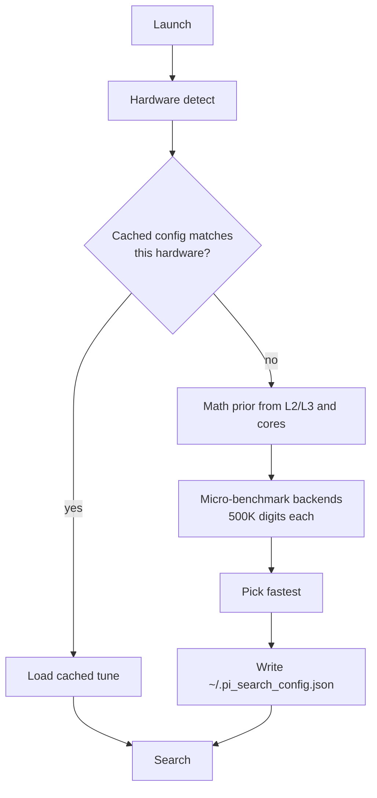

<div align="center">


<br/><br/>

**Find any number — or any word — hidden inside the digits of π.**

Self-tuning · Cross-platform · Benchmarks your CPU before it searches a single digit

<a href="https://git.io/typing-svg"></a>

<br/>


<br/>
[](https://github.com/Rakeshlenka943/pi-pattern-searcher/actions/workflows/test.yml)


<br/>

[**🚀 Try it in your browser**](https://codespaces.new/Rakeshlenka943/pi-pattern-searcher)
·
[**⚡ Quickstart**](#-quickstart)
·
[**🎮 Usage**](#-usage)
·
[**🧠 How it tunes itself**](#-how-it-tunes-itself)
·
[**🗺️ Roadmap**](#%EF%B8%8F-roadmap)

</div>

---

`pi-search` generates π with the fastest backend your machine can actually run, searches it with the right algorithm for your pattern length, and then tells you the probability your pattern *should* have appeared by now.

It is not a wrapper around a 100 MB text file. It computes π on demand, measures your hardware, caches the winning configuration, and adapts when it has to.

> [!TIP]
> **New here?** Click **Try it in your browser** above. It spins up a free cloud IDE with the project pre-installed — click the green **Create codespace** button and you're searching π in about 30 seconds. No local setup.

## ✨ Features

| | Feature | Why it matters |
|---|---|---|
| 🔍 | **Search numbers or words** | `pi-search 14159` or `pi-search --word Aman` (ASCII-encoded) |
| ⚙️ | **Three π backends** | `gmpy2`, `mpmath`, dependency-free `spigot` — auto-selected |
| 🧮 | **Three search algorithms** | Naive (≤4 digits), KMP (≤100), Rabin–Karp (>100) |
| 🖥️ | **Real hardware detection** | CPU, cores, L1/L2/L3, RAM, AVX2/AVX-512, GPU, compiler |
| 🎯 | **Micro-benchmarked autotune** | Tunes on *your* machine, caches by fingerprint |
| 📈 | **Live probability model** | Poisson estimate of `P(seen)` and expected remaining digits |
| 🖱️ | **Interactive menu** | Kali-style numbered menus when run with no arguments |
| ♾️ | **Unlimited mode** | Doubling search with RAM-safe ceiling |
| 🎨 | **Rotating ASCII banner** | Five π artworks, drawn at random each launch |

## 🚀 Quickstart

```bash
sudo apt install -y python3-venv python3-dev build-essential \
                    libgmp-dev libmpfr-dev libmpc-dev pkg-config

git clone https://github.com/Rakeshlenka943/pi-pattern-searcher.git
cd pi-pattern-searcher
python3 -m venv .venv && source .venv/bin/activate
pip install -e ".[dev]"

pi-search
```

## 🎮 Usage

```bash
pi-search                          # interactive menu
pi-search 14159                    # find a digit sequence
pi-search --word Hi                # find "Hi" → 072105
pi-search 42 --unlimited           # doubling until found or RAM cap
pi-search 123456 --progress        # live digits/s display
pi-search 999999 --save-on-found pi.txt
```

## 🧠 How it tunes itself



Real cached config on an i3-8130U:

```json
{
  "backend": "mpmath",
  "chunk_size": 262144,
  "threads": 2,
  "benchmarked": { "gmpy2": 0.4156, "mpmath": 0.3287 }
}
```

`262144` = 256 KB = per-core L2 of that CPU. Nothing hardcoded.

## ⚡ Performance

**Intel i3-8130U**, 2 cores, 11.6 GB RAM:

| Digits | Time | Rate | Peak RAM |
|---|---|---|---|
| 1 M | ~0.63 s | 1.6 M/s | ~5 MB |
| 10 M | ~10 s | 1.0 M/s | ~50 MB |
| 100 M | ~100 s | 1.0 M/s | ~500 MB |
| 1 B | ~17 min | 1.0 M/s | ~5 GB |

Generation is the bottleneck, not search. That's exactly what the roadmap targets.

## 🗺️ Roadmap

- [x] **v0.1** — encoding, KMP + naive, streaming, CLI
- [x] **v0.2** — hardware detection, autotune, Rabin–Karp, interactive menu, unlimited mode
- [ ] **v0.3** — C extension: binary-splitting Chudnovsky → target **5–15× faster generation**
- [ ] **v0.4** — file-cached generation for repeated 100M+ searches
- [ ] **v0.5** — multithreaded search
- [ ] **v0.6** — Aho–Corasick multi-pattern
- [ ] **v1.0** — optional CUDA backend, PyPI release

## 📜 License

MIT
