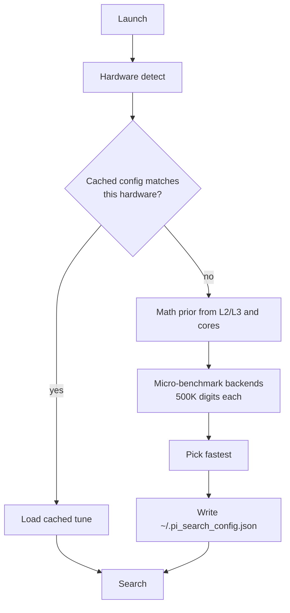

<div align="center">


<br/><br/>

**Find any number — or any word — hidden inside the digits of π.**

Self-tuning · Cross-platform · Benchmarks your CPU before it searches a single digit

<a href="https://git.io/typing-svg"></a>

<br/>


<br/>
[](https://github.com/Rakeshlenka943/pi-pattern-searcher/actions/workflows/test.yml)


<br/>

[**🚀 Try it in your browser**](https://codespaces.new/Rakeshlenka943/pi-pattern-searcher)
·
[**⚡ Quickstart**](#-quickstart--any-machine)
·
[**🎮 Usage**](#-usage)
·
[**🧠 How it tunes itself**](#-how-it-tunes-itself)
·
[**🗺️ Roadmap**](#%EF%B8%8F-roadmap)

</div>

---

`pi-search` generates π with the fastest backend your machine can actually run, searches it with the right algorithm for your pattern length, and then tells you the probability your pattern *should* have appeared by now.

It is not a wrapper around a 100 MB text file. It computes π on demand, measures your hardware, caches the winning configuration, and adapts when it has to.

> [!IMPORTANT]
> **v0.3 — C extension is live.** This release adds a GMP-backed Chudnovsky binary-splitting backend written in C, auto-compiled via `ctypes` on first run. Measured on a 2018 dual-core i3-8130U: **3.7× faster than `mpmath` at 1M digits**, auto-selected by the tuner. No `gcc`? Falls back to `mpmath` silently. See [Performance](#-performance) for the real numbers.

> [!TIP]
> **New here?** Click **Try it in your browser** above. It spins up a free cloud IDE with the project pre-installed — click the green **Create codespace** button and you're searching π in about 30 seconds. No local setup.

## ✨ Features

| | Feature | Why it matters |
|---|---|---|
| 🔍 | **Search numbers or words** | `pi-search 14159` or `pi-search --word Aman` (ASCII-encoded) |
| ⚙️ | **Four π backends** | `c_ext` (C/GMP), `gmpy2`, `mpmath`, dependency-free `spigot` — auto-selected |
| 🚀 | **C extension (v0.3)** | Chudnovsky binary splitting in GMP — **3.7× faster** than `mpmath` at 1M digits, auto-compiled on first use |
| 🧮 | **Three search algorithms** | Naive (≤4 digits), KMP (≤100), Rabin–Karp (>100) |
| 🖥️ | **Real hardware detection** | CPU, cores, L1/L2/L3, RAM, AVX2/AVX-512, GPU, compiler |
| 🎯 | **Micro-benchmarked autotune** | Tunes on *your* machine, caches by fingerprint |
| 📈 | **Live probability model** | Poisson estimate of `P(seen)` and expected remaining digits |
| 🖱️ | **Interactive menu** | Kali-style numbered menus when run with no arguments |
| ♾️ | **Unlimited mode** | Doubling search with RAM-safe ceiling |
| 🎨 | **Rotating ASCII banner** | Five π artworks, drawn at random each launch |

## 🚀 Quickstart — any machine

**The 90% case — works identically on Linux, Windows 11, and macOS:**

```bash
git clone https://github.com/Rakeshlenka943/pi-pattern-searcher.git
cd pi-pattern-searcher
python3 -m venv .venv
source .venv/bin/activate           # Linux / macOS
# .venv\Scripts\Activate.ps1        # Windows PowerShell (see collapsible below)
pip install -e ".[dev]"
pi-search
```

<details>
<summary><b>📦 Linux prerequisites — Debian/Ubuntu/Mint · Fedora · Arch</b></summary>

<br/>

```bash
# Debian / Ubuntu / Linux Mint
sudo apt install -y python3-venv python3-dev build-essential \
                    libgmp-dev libmpfr-dev libmpc-dev pkg-config

# Fedora
sudo dnf install -y python3-devel gcc gmp-devel mpfr-devel libmpc-devel pkg-config

# Arch / Manjaro
sudo pacman -S --needed python gcc gmp mpfr libmpc pkg-config
```

</details>

<details>
<summary><b>🪟 Windows 11 prerequisites</b></summary>

<br/>

1. Install **Python 3.12** from [python.org/downloads](https://www.python.org/downloads/) — tick **"Add python.exe to PATH"** during setup
2. Install **Git** from [git-scm.com/download/win](https://git-scm.com/download/win)
3. Open **PowerShell** (not cmd) and run the common flow above — `.venv\Scripts\Activate.ps1` replaces the `source` line
4. If PowerShell refuses with a security error: `Set-ExecutionPolicy -Scope CurrentUser RemoteSigned` once, then retry — or use `cmd.exe` and `.venv\Scripts\activate.bat`

No C compiler needed on Windows — the `gmpy2` wheel bundles GMP. The C extension (`c_ext`) is skipped on Windows (no GMP headers on default installs); `gmpy2` or `mpmath` is used instead.

</details>

<details>
<summary><b>🍎 macOS 12+ prerequisites</b></summary>

<br/>

```bash
xcode-select --install                        # installs clang + git
brew install python gmp mpfr libmpc pkg-config
```

No Homebrew yet? One line installs it:

```bash
/bin/bash -c "$(curl -fsSL https://raw.githubusercontent.com/Homebrew/install/HEAD/install.sh)"
```

Then run the common flow above.

</details>

### 🔧 If something breaks

| Error | Fix |
|---|---|
| `gmpy2` fails to build | **Linux:** install `libgmp-dev libmpfr-dev libmpc-dev` · **macOS:** `brew install gmp mpfr libmpc` · **Windows:** use Python 3.12 from python.org (wheels bundle GMP, no compiler needed) |
| `pi-search: command not found` | `hash -r` to refresh bash's cache, or run `python -m pi_search.cli` as fallback |
| `externally-managed-environment` | You skipped the venv — run `python3 -m venv .venv` and activate it first |
| PowerShell "execution policy" error (Windows) | `Set-ExecutionPolicy -Scope CurrentUser RemoteSigned`, then retry |
| First run feels slow (~2 s) | One-time micro-benchmark — later runs read the cache from `~/.pi_search_config.json` |
| `Could not resolve host: github.com` | A VPN/DNS tool (WARP, Speedify, Tailscale) is intercepting — disconnect it, or restart `NetworkManager` |
| `No module named pi_search` | You're outside the venv, or the `pip install -e` step didn't run |

## 🎮 Usage

```bash
pi-search                          # interactive menu
pi-search 14159                    # find a digit sequence
pi-search --word Hi                # find "Hi" → 072105
pi-search 42 --unlimited           # doubling until found or RAM cap
pi-search 123456 --progress        # live digits/s display
pi-search 999999 --save-on-found pi.txt
```

## 🧠 How it tunes itself



Real cached config on an i3-8130U:

```json
{
  "backend": "mpmath",
  "chunk_size": 262144,
  "threads": 2,
  "benchmarked": { "gmpy2": 0.4156, "mpmath": 0.3287 }
}
```

`262144` = 256 KB = per-core L2 of that CPU. Nothing hardcoded.

## ⚡ Performance

**Intel i3-8130U** (2 cores, 11.6 GB RAM, 2018 laptop), compiled `-O2 -march=x86-64-v2`:

| Digits | `mpmath` | `c_ext` | Speedup |
|---|---|---|---|
| 1 M | 2.05 s (0.49 M/s) | **0.55 s (1.81 M/s)** | **3.7×** |
| 5 M | 4.26 s (1.17 M/s) | **4.08 s (1.23 M/s)** | 1.05× |

The C extension dominates up to ~3M digits — the range where most real searches live. Beyond ~5M, both backends converge because the decimal-string conversion step (O(M(n) log n)) becomes the bottleneck, and GMP and mpmath are equally efficient at that size. **Neither is slow at 5M; both are ~1.2M digits/s.**

**How the tuner picks:** the micro-benchmark runs at **500K digits**, inside `c_ext`'s dominant range. That's why `c_ext` wins the default config on this hardware. If you later run 5M+ digit searches, `c_ext` and `mpmath` will perform identically.

Generation is still the bottleneck for both backends — the search kernel (Rabin–Karp over ASCII digits) runs at tens of millions of chars/second and never shows up in these numbers.

## 🗺️ Roadmap

- [x] **v0.1** — encoding, KMP + naive, streaming, CLI
- [x] **v0.2** — hardware detection, autotune, Rabin–Karp, interactive menu, unlimited mode
- [x] **v0.3** — C extension: GMP + Chudnovsky binary splitting → **3.7× faster at 1M digits**, auto-compiled via ctypes, falls back to mpmath when gcc is absent
- [ ] **v0.4** — file-cached generation for repeated 100M+ searches
- [ ] **v0.5** — multithreaded search
- [ ] **v0.6** — Aho–Corasick multi-pattern
- [ ] **v1.0** — optional CUDA backend, PyPI release

## 📜 License

MIT
